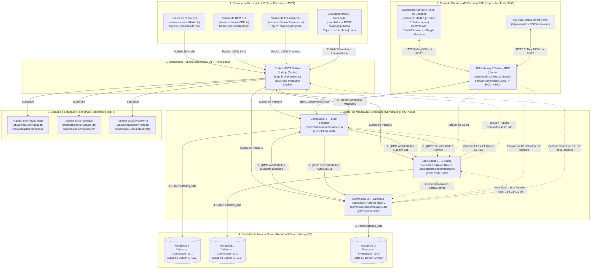

# Relatório Acadêmico e Manual Técnico — Middleware IoT Diverterapia

> **Disciplina:** Sistemas Distribuídos  
> **Projeto:** Plataforma IoT de Regulação Sensorial Pediátrica com Replicação de Dados, Alta Disponibilidade (*Failover* em 2 Níveis) e Tolerância a Falhas Bizantinas (*Quorum* 2x1)  
> **Estrutura Metodológica:** Relatório orientado às diretrizes do professor e organizado segundo o framework internacional **Diátaxis** (*Explanation*, *Tutorial*, *How-To Guides* e *Reference*).

---

## 📋 Sumário Executivo (Mapa de Respostas às Orientações do Professor)

Este relatório apresenta o funcionamento completo do **Middleware IoT Distribuído Diverterapia** e detalha as soluções de engenharia implementadas para resolver os três desafios centrais propostos na disciplina:

1. **Replicação de Dados Armazenados ("O controlador escolhido possui sempre uma ou várias réplicas para os dados armazenados"):**  
   $\rightarrow$ Resolvido com arquitetura *Shared-Nothing* em **3 instâncias independentes de MongoDB** (`diverterapia_ctrl1`, `diverterapia_ctrl2` e `diverterapia_ctrl3`), **Replicação de Máquina de Estados (SMR)** via `regrasClinicas.ts`, protocolo em duas fases via gRPC (`VotarEstado` $\rightarrow$ `EfetivarEstado`), **Crash-Recovery** no boot e **Catch-up automático** para ressincronização sem perda de dados após quedas.
2. **Disponibilidade e Garantia de Retorno ao Cliente ("Garantir que o cliente obtenha um resultado positivo quanto à execução de um método, mesmo que o controlador caia"):**  
   $\rightarrow$ Resolvido com ***Failover* Transparente no Cliente/Gateway** (`3001` $\rightarrow$ `3002` $\rightarrow$ `3003`), **Detecção de Falhas via *Heartbeat* gRPC** a cada `1500ms` e **Promoção Automática de Líder Interino em 2 Níveis** (`Controlador 1` $\rightarrow$ `Controlador 2` $\rightarrow$ `Controlador 3` em modo honesto), garantindo execução remota de métodos e acionamento contínuo dos atuadores físicos mesmo diante de múltiplas falhas por parada (*Crash Faults*).
3. **Segurança, Invasão e Erros Intermitentes ("Resolver problemas de segurança: se os controladores começarem a responder valores que não conferem, seja por motivo de terem sido invadidos ou por erros intermitentes?"):**  
   $\rightarrow$ Resolvido com **Consenso de *Quorum* 2x1 pré-persistência e pré-atuação**, **Comparação Estrita de Assinatura de Estado** (`compararEstados()` rejeitando valores forjados como `999 dB` / `250 BPM`), **Autocura (*Self-Healing*) do banco do nó invadido** via `EfetivarEstado`, **Sanity Checks clínicos e bloqueio de leitura/liderança bizantina** no Gateway e no Controlador 3, além de um conjunto anti-*race condition* (fila FIFO `enfileirarOperacao`, espera ativa de até `160ms` e *retry* determinístico) para neutralizar atrasos intermitentes de rede.

---

## 📌 PARTE 1 (Explanation): Apresentação do Trabalho e Funcionamento Geral

### 1.1 Contexto Clínico e Objetivo do Sistema

O **Diverterapia** é um sistema distribuído em tempo real projetado para **Salas Pediátricas Inteligentes** voltadas ao atendimento e acolhimento de crianças neurodivergentes — com foco especial em **Transtorno do Espectro Autista (TEA)**, **TDAH** e hipersensibilidade sensorial.

Variações bruscas de estímulos no ambiente hospitalar ou clínico (como aumento súbito de ruído acústico ou taquicardia por estresse) podem desencadear crises sensoriais severas. Para mitigar esses riscos de forma autônoma, confiável e auditável, o middleware integra dispositivos IoT de percepção e atuação sob coordenação de um cluster de controladores distribuídos:

- **Percepção em Tempo Real (Sensores MQTT):** Monitora o nível de ruído ambiente em decibéis (`dB`), a frequência cardíaca do paciente em batimentos por minuto (`BPM`) e a presença física junto às preferências do paciente em atendimento (`tagId`, `corFavorita`, `musicaFavorita`).
- **Regulação Ambiental Automática (Atuadores MQTT):** Ajusta três dispositivos físicos na sala pediátrica:
  1. **Iluminação RGB (`clinica/sala1/comando/luz`):** Alterna entre `Azul / Calmante`, `Verde / Viva`, `Branca / Alto Contraste` ou a `Cor Favorita` da criança.
  2. **Smart Speaker (`clinica/sala1/comando/som`):** Reproduz `Frequência Calmante (Ruído Branco)`, `Sons da Natureza`, `Isolamento Acústico` ou a `Playlist do Paciente`.
  3. **Visor da Porta (`clinica/sala1/comando/display`):** Exibe avisos operacionais na porta externa, como `> Regulação em Curso (Não Entre)` ou `> Em Atendimento (<Nome>)`.
- **Operação Clínica Multi-Cliente (gRPC via BFF Next.js):** Médicos (`Cliente 1`) e equipe de enfermagem (`Cliente 2`) acompanham a sala em tempo real e invocam métodos remotos orientados a objetos (`AtivarModoCalmaManual` e `InvocarMetodo` com `configurarAtuadores`), aplicando uma trava de prioridade manual (*override* de `15 segundos`) sobre leituras automáticas.

---

### 1.2 Arquitetura em 6 Camadas e Fluxo Ponta a Ponta

A arquitetura desacopla completamente a borda IoT, o núcleo de consenso distribuído, a camada de persistência isolada e a aplicação cliente web:

---

## 🎯 PARTE 2 (Explanation): Soluções para os Problemas Propostos pelo Professor

Esta parte responde diretamente a cada uma das questões formuladas nas orientações do trabalho prático de Sistemas Distribuídos.

---

### 2.1 Problema 1: *"O controlador escolhido possui sempre uma ou várias réplicas para os dados armazenados"*

#### Solução Implementada
Adotamos uma arquitetura de **Persistência Isolada (*Shared-Nothing*) combinada com Replicação de Máquina de Estados (*State Machine Replication* — SMR)** e **Replicação Síncrona em Duas Fases coordenada pelo Líder**, complementada por **Crash-Recovery** e **Catch-up automático**.

1. **Três Bancos de Dados Independentes (1 Instância por Controlador):**
   - Cada controlador carrega sua própria variável de ambiente via `resolverUriMongo()` no módulo [controladores/persistenciaMongo.ts](file:///c:/Users/arthur/Desktop/IF/Trabalho%20Sistemas%20Distribuidos/trabalho-pratico-sd/controladores/persistenciaMongo.ts):
     - **Controlador 1 (`:3001`):** conecta via `MONGO_URI_1` ao banco `diverterapia_ctrl1` (MongoDB Atlas Cloud) ou `127.0.0.1:27017/diverterapia` (Docker).
     - **Controlador 2 (`:3002`):** conecta via `MONGO_URI_2` ao banco `diverterapia_ctrl2` (MongoDB Atlas Cloud) ou `127.0.0.1:27018/diverterapia` (Docker).
     - **Controlador 3 (`:3003`):** conecta via `MONGO_URI_3` ao banco `diverterapia_ctrl3` (MongoDB Atlas Cloud) ou `127.0.0.1:27019/diverterapia` (Docker).
   - Não existe compartilhamento de arquivo local JSON nem gravação em banco único: a queda de um banco ou controlador não apaga os dados das réplicas.

2. **Replicação Determinística Pré-Commit (`VotarEstado` $\rightarrow$ `EfetivarEstado`):**
   - Ao receber um pacote MQTT de sensor ou uma chamada gRPC de cliente, o Líder (`controlador1.ts`) **não grava imediatamente**.
   - Ele gera um `estadoCandidato` em RAM usando as funções puras de [controladores/regrasClinicas.ts](file:///c:/Users/arthur/Desktop/IF/Trabalho%20Sistemas%20Distribuidos/trabalho-pratico-sd/controladores/regrasClinicas.ts) e executa `executarQuorumLider()`.
   - Aprovado o *Quorum*, o Líder persiste o snapshot consolidado (com histórico de até 15 registros) no **MongoDB 1** e dispara em paralelo a RPC `EfetivarEstado` (`ordenarEfetivacaoNasReplicas`) para o **Controlador 2** e o **Controlador 3**, que executam *upsert* atômico na coleção `estados_sala` dos **MongoDBs 2 e 3**.

3. **Recuperação de Estado após Quedas (*Crash-Recovery*, *Catch-up* e *Fallback RAM*):**
   - **No Boot (*Crash-Recovery*):** A função `persistenciaMongo.inicializar()` lê o documento persistido no próprio MongoDB do nó antes de abrir o servidor gRPC ou assinar o MQTT, restaurando o último estado válido do disco.
   - **Sincronização Pós-Queda (*Catch-up* via gRPC):**
     - Se o **Controlador 1** cair e depois voltar (ou for revivido via botão na UI), ele chama `sincronizarCatchUpComReplica2()`, consulta `ObterStatus` no Controlador 2 (`:3002`) e usa a função determinística `deveAbsorverEstadoRemoto(estadoLocal, estadoReplica2)` para verificar se houve transações durante sua ausência. Em caso positivo, absorve o estado mais novo e atualiza o MongoDB 1.
     - O mesmo ocorre quando **Controlador 2** ou **Controlador 3** reiniciam/revivem, através de `sincronizarCatchUpComLider()`, consultando o Controlador 1 (com fallback automático para o Controlador 2).
   - **Resiliência a Quedas do Próprio Banco (*Fallback RAM*):** Se uma instância do MongoDB ficar temporariamente inacessível, `persistenciaMongo.ts` reporta explicitamente `MongoDB X [OFFLINE - RAM]`, mantém a operação clínica em memória RAM e dispara um monitor periódico a cada **`10 segundos`** que reconecta automaticamente ao MongoDB e sincroniza o estado mais recente assim que o banco retorna.

---

### 2.2 Problema 2: *"Garantir que o cliente obtenha um resultado positivo quanto à execução de um método, mesmo que o controlador caia"*

#### Solução Implementada
Implementamos tolerância a **Falhas por Parada (*Crash-Stop / Crash-Recovery*) em dupla camada** (no cliente/gateway e dentro do cluster de controladores), garantindo que o cliente (`Cliente 1 - Médico` ou `Cliente 2 - Enfermagem`) sempre receba confirmação de sucesso desde que exista ao menos um controlador íntegro operante:

1. **Redirecionamento Transparente (*Failover* no Cliente/Gateway gRPC):**
   - Tanto os métodos de cliente no Dashboard ([cliente-dashboard/src/app/page.tsx](file:///c:/Users/arthur/Desktop/IF/Trabalho%20Sistemas%20Distribuidos/trabalho-pratico-sd/cliente-dashboard/src/app/page.tsx)) quanto as funções `ativarModoCalmaComFailover()` e `invocarMetodoComFailover()` em [cliente-dashboard/src/lib/grpcClient.ts](file:///c:/Users/arthur/Desktop/IF/Trabalho%20Sistemas%20Distribuidos/trabalho-pratico-sd/cliente-dashboard/src/lib/grpcClient.ts) tentam executar a RPC seguindo a hierarquia **`3001 (Controlador 1)` $\rightarrow$ `3002 (Controlador 2)` $\rightarrow$ `3003 (Controlador 3)`**.
   - Caso o Controlador 1 tenha caído (processo encerrado ou em simulação de *Crash* retornando `grpc.status.UNAVAILABLE`), o *loop* captura o erro dentro do *timeout* de `1500ms`, registra o evento no **Console de Auditoria & Failover** e reenvia a invocação transparente ao próximo nó saudável, retornando resposta positiva ao terapeuta.

2. **Promoção Automática de Líder Interino em 2 Níveis (`C1` $\rightarrow$ `C2` $\rightarrow$ `C3`):**
   - **Failover de 1º Nível (`controlador2.ts`):** A função `iniciarMonitoramentoLider()` dispara *heartbeats* via gRPC (`clientLider1.ObterStatus`) a cada **`1500ms`** com prazo máximo (*deadline*) de **`600ms`**. Se o Controlador 1 não responder, o Controlador 2 assume imediatamente como **Líder Interino (`👑 LIDER_INTERINO`)** — além de responder às RPCs do cliente (`AtivarModoCalmaManual` e `InvocarMetodo`), ele passa a processar os sensores MQTT, validar votos junto ao C3 (`executarComoLiderInterino()`), gravar no `MongoDB 2`, replicar para o `MongoDB 3` e comandar os atuadores físicos.
   - **Failover de 2º Nível (`controlador3.ts`):** Se **tanto o Controlador 1 quanto o Controlador 2** caírem, a rotina `iniciarMonitoramentoLideres()` no Controlador 3 detecta via *heartbeat* que ambos estão offline. Se o Controlador 3 **não estiver com falha bizantina ativa** (`!simularFalhaBizantina`), ele assume automaticamente o papel de **Líder Interino (`👑 LIDER_INTERINO`)**, processando métodos remotos dos clientes, telemetria MQTT, gravações no `MongoDB 3` e despacho aos atuadores físicos.

3. **Devolução Pacífica de Liderança e Simulação Real via Interface:**
   - Quando um nó superior volta ao ar, ele primeiro executa seu *Catch-up* para recuperar tudo o que perdeu. No pulso seguinte do *heartbeat* (`1500ms`), o líder interino detecta o retorno do superior e devolve a liderança pacificamente (`liderPrincipalOnline = true` no C2; `lideresSuperioresOnline = true` no C3).
   - Para demonstrar isso sem precisar encerrar terminais manualmente, a RPC `AlternarStatusOperacional` alterna a flag `falhaParadaSimulada` em qualquer um dos 3 controladores, fazendo o nó simulado rejeitar todas as chamadas gRPC com `grpc.status.UNAVAILABLE` e descartar pacotes MQTT como um *Crash* real.

---

### 2.3 Problema 3: *"Resolver problemas de segurança: se os controladores começarem a responder valores que não conferem, seja por motivo de terem sido invadidos ou por erros intermitentes?"*

#### Solução Implementada
O sistema trata **dois subproblemas distintos** mencionados pelo professor: **invasão/adulteração maliciosa (Falha Bizantina)** e **erros intermitentes / atrasos transitórios de rede**.

#### A) Combate a Invasões e Respostas Maliciosas (Falhas Bizantinas)

1. **Por que Média Aritmética Falha em IoT Distribuído:**  
   Se uma criança está em ambiente calmo (`62 dB`) e um controlador invadido responde `999 dB`, uma média simples resultaria em `374 dB` — disparando falsos alarmes clínicos. Por isso, substituímos cálculos aritméticos por **Consenso de Votação por Maioria Estrita (*Quorum* 2x1)** aplicado **antes** da persistência no banco e **antes** do acionamento dos atuadores.

2. **Votação com Comparação Semântica de Assinatura (`compararEstados`):**  
   Ao receber `VotarEstado`, as réplicas devolvem o estado completo calculado localmente. O Líder aplica a função `compararEstados(candidato, votado)` em [controladores/regrasClinicas.ts](file:///c:/Users/arthur/Desktop/IF/Trabalho%20Sistemas%20Distribuidos/trabalho-pratico-sd/controladores/regrasClinicas.ts):
   - **Bloqueio de assinaturas de ataque:** Rejeita imediatamente votos contendo tags como `'BIZANTINO'` ou `'HACKED'`.
   - **Tolerância numérica estrita:** Rejeita qualquer voto com diferença superior a `5 dB` no ruído (`999 dB` do C3 invadido é descartado na hora) ou superior a `5 BPM` na frequência cardíaca (`250 BPM` do C3 é descartado na hora).
   - **Concordância integral dos atuadores e estado:** Exige igualdade exata em `presenca`, `modoCalmaAtivo`, `tagId`, `iluminacao`, `smartSpeaker` e `displayPorta`.
   - Com **C1 + C2 concordando (2/3 votos)**, o *Quorum* 2x1 vence a maioria e isola o voto corrompido do C3.

3. **Sanity Checks na Réplica e Rejeição de Nó Bizantino no Gateway e na Liderança:**
   - Em chamadas manuais (`INVOCACAO_METODO`), `VotarEstado` nas réplicas honestas (C2 e C3 em modo honesto) verifica limites físicos válidos (`0 <= ruido <= 150` e `0 <= bpm <= 220`), impedindo que até mesmo um pedido corrompido passe despercebido.
   - No Gateway (`grpcClient.ts` e `api/status/route.ts`), `obterDiagnosticoCluster` e `obterStatusComFailover` **ignoram explicitamente** qualquer controlador cuja `integridade === 'FALHA_BIZANTINA'` ou cujo retorno seja `sucesso === false`, garantindo que dados adulterados jamais apareçam como estado oficial para o médico.
   - No **Controlador 3** (`controlador3.ts`), caso C1 e C2 caiam enquanto `simularFalhaBizantina === true`, o C3 é **impedido de assumir a liderança interina** e recusa executar mutações (`ativarModoCalmaManual` e `configurarAtuadores` retornam `sucesso: false`).

4. **Autocura do Banco Corrompido (*Self-Healing*):**  
   Após o *Quorum* 2x1 aprovar o estado legítimo, o Líder envia `EfetivarEstado` com o `estadoValidado` para todas as réplicas — **incluindo o Controlador 3**. O handler `EfetivarEstado` do C3 sobrescreve seu estado local e o documento do `diverterapia_ctrl3` com a verdade validada pela maioria, evitando divergência permanente no disco.

#### B) Combate a Erros Intermitentes e Condições de Corrida (*Race Conditions*)

Em redes reais, mensagens publicadas no barramento MQTT chegam aos assinantes com diferença de alguns milissegundos. Sem sincronização, uma réplica honesta atrasada poderia votar com o valor anterior e parecer um nó invadido (**falso positivo**), ou pacotes consecutivos poderiam corromper a memória. Resolvemos isso em **4 camadas**:

1. **Fila FIFO Sequencial (`enfileirarOperacao`):** Todas as mensagens MQTT e chamadas gRPC no Líder entram em fila encadeada de promessas, impedindo que duas mutações disputem `estadoLocal` ao mesmo tempo.
2. **Timestamp Determinístico na Origem:** O timestamp ISO é carimbado na publicação do sensor / ponte `/api/mqtt/publish`, permitindo que todas as réplicas calculem exatamente a mesma transição e a mesma janela de *override* manual.
3. **Janela de Propagação e Espera Ativa Sincronizada:** Antes de abrir o turno de votação para eventos MQTT, o Líder aguarda **`40ms`**. Ao receber `VotarEstado`, a réplica verifica se seu `estadoTelemetria.ultimaAtualizacao` já coincide com o `ultimaAtualizacao` do candidato do Líder; se o pacote MQTT ainda estiver em trânsito, a réplica aguarda até **`160ms`** (em 8 verificações de `20ms`) antes de emitir o voto.
4. **Retry Determinístico em Caso de Divergência Transitória:** Se a Réplica 2 ainda assim divergir por atraso intermitente na primeira rodada MQTT, o Líder executa 1 *retry* automático após **`80ms`** (`realizarTurnoVotacao`), além de configurar backoff rápido HTTP/2 (`150ms`–`1000ms`) e `waitForReady: true` nos metadados gRPC para absorver oscilações de canal.

---

*Relatório elaborado para a disciplina de **Sistemas Distribuídos** — Projeto **Middleware IoT Diverterapia**.*
